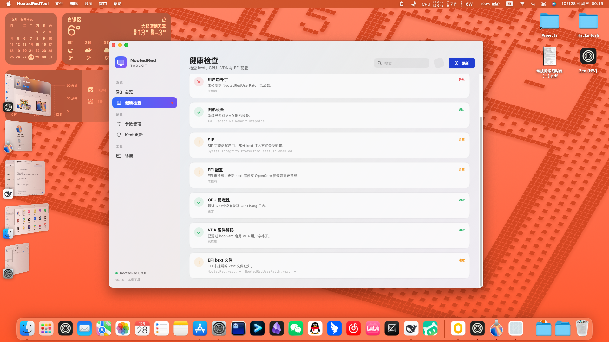
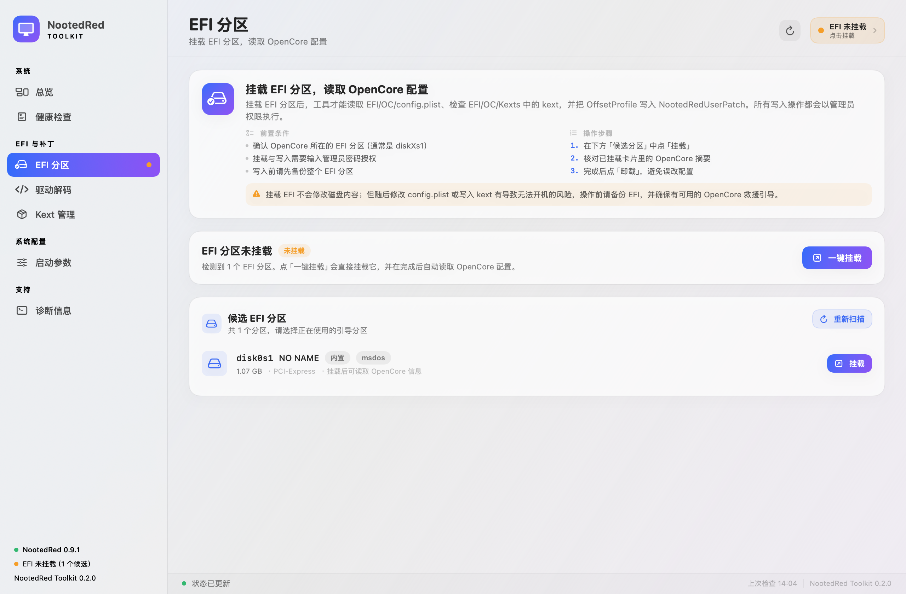
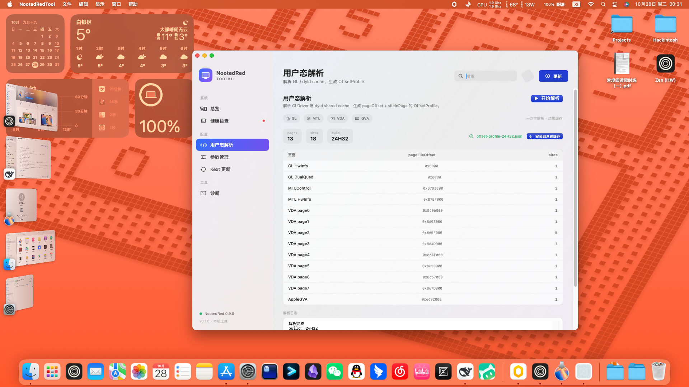

# NootedRed Toolkit

macOS 15+ 的 SwiftUI 工具（附 CLI）：检查本机 NootedRed 状态、挂载 EFI、管理 boot-args、生成并注入
用户态补丁 profile。当前版本 **0.2.0**。

界面按功能分为四个组、七个页面：

| 分组 | 页面 | 作用 |
| --- | --- | --- |
| 系统 | 总览 | 机器信息、健康摘要、部署流程 |
| 系统 | 健康检查 | 逐项检查主 kext、卫星、GPU、SIP、EFI、OpenCore 配置、kext 文件、profile、GPU hang 与 VDA（共 17 项） |
| EFI 与补丁 | EFI 分区 | 发现/挂载/卸载 EFI，读取 OpenCore 配置摘要 |
| EFI 与补丁 | 驱动解码 | 解码 GL/Metal/VDA/GVA 驱动并生成 profile（见下方「已知缺口」） |
| EFI 与补丁 | Kext 管理 | 对比 `EFI/OC/Kexts` 与 `config.plist` 的 `Kernel > Add`（本版本只显示，不执行更新） |
| 系统配置 | 启动参数 | 按功能补丁/调试/日志/救援分组勾选 boot-args，写入 NVRAM |
| 支持 | 诊断信息 | 汇总系统/kext/EFI/OpenCore 信息，一键复制 |

## 界面预览

总览页：



EFI 分区页（未挂载状态）：



驱动解码页：



## 当前可用的 profile 流程

卫星只认 `Info.plist` 里注入的 `NRedProfiles` 数组（NRPT v3）。可用路径是 CLI + `test/` 下的工具：

```sh
# 1. 从干净 fixture 生成（不要在卫星已加载的系统上生成）
.build/release/NootedRedTool --generate-profile <fixture-root> --out build/profile

# 2. 独立校验
python3 ../test/nrpt_validator.py --profile build/profile/nred-<build>.nrpt \
  --fixtures <fixture-root> --expected-build <build> --device-id 0x1638 --mutation-sweep

# 3. 注入 EFI 里的 kext（写入后回读校验）
KEXT=/Volumes/EFI/EFI/OC/Kexts/NootedRedUserPatch.kext
python3 ../test/inject_profile.py --info-plist "$KEXT/Contents/Info.plist" \
  --profile build/profile/nred-<build>.nrpt --build <build> --apumask 0x28 --deviceid 0x1638
python3 ../test/inject_profile.py --info-plist "$KEXT/Contents/Info.plist" --check
```

多 build/APU 共存用 `--bundle-profiles`（manifest 见 `Sources/NootedRedTool/PatchAnalyzer/ProfileBundle.swift`），
输出可直接作为 `NRedProfiles` 数组的条目来源。

### 已知缺口（GUI 驱动解码页）

GUI 的「驱动解码」通过 `OffsetProfileGenerator` 生成并以 `NRedOffsetProfile` / `NRP3` 写回
personality，**当前卫星不读取这个键**——它只读 `NRedProfiles`。因此「写入 EFI → 重启生效」这一步在
本版本不成立，写入后的回读校验也只验证了这个被忽略的旧键。

在 GUI 接到 v3 生成器之前，请用上面的 CLI 流程。`NootedRedTool --self-test` 与健康检查目前同样以
旧键为准，相关检查项会给出误导性的「已写入」。

## EFI 分区挂载

工具通过 `diskutil -plist` 发现所有 `Content == EFI` 的分区（不解析本地化文本），显示设备号、卷名、
大小、内置/外置、挂载状态。挂载/卸载通过 `osascript` 提权执行，操作后重新探测挂载点确认成败。

1. 在「EFI 分区」页确认 OpenCore 所在的引导分区（通常是 `diskXs1`）；
2. 点「挂载」，在系统弹窗中输入管理员密码；
3. 核对已挂载卡片里的 OpenCore 摘要（config 路径、ProductName、`Kernel > Add` 条目数、NootedRed 启用状态）；
4. 完成读写后点「卸载」；提示卷被占用时可先保存修改再强制卸载。

安全提示：

- 挂载与写入 EFI 需要管理员授权。操作前**备份整个 EFI 分区**，并保留可用的救援引导。
- 修改 `config.plist` 或写 kext 有导致无法开机的风险。
- 工具只读本机文件，不上传任何内容；用完建议卸载 EFI。
- 有多个 EFI 分区时工具不会猜，需要手动选择。

## 其他页面

- 健康检查：按「异常 / 注意 / 信息 / 通过」分级，每项带处理建议与「前往处理」入口。
- Kext 管理：显示已启用/已禁用/未加入 config/文件缺失；更新入口仅保留界面。
- 启动参数：勾选后写入 NVRAM `boot-args`，需要管理员授权，重启生效；不认识的现有参数会保留。
- 诊断信息：只读汇总，可直接粘贴到 issue。
- 健康检查中的 GPU hang 查询最近 5 分钟系统日志。

## 命令行模式

```sh
.build/release/NootedRedTool --efi-probe              # 只读探测 EFI 分区与 OpenCore 摘要
.build/release/NootedRedTool --self-test              # 无界面自检（codec、Info.plist 注入、健康检查分支）
.build/release/NootedRedTool --snapshot [输出目录]     # 离屏渲染 7 个页面为 PNG（默认 $TMPDIR/nootedred-snapshots）
.build/release/NootedRedTool --generate-profile <fixture-root> --out <dir>
.build/release/NootedRedTool --validate-profile <profile.nrpt> --fixture-root <fixture-root>
.build/release/NootedRedTool --bundle-profiles <manifest.json> --out <dir>
```

`--parser` / `--parse` / `--decode` / `--decode-run` 兼容旧用法：打开应用并进入（或自动开始）驱动解码页。
`--profile-*` 系列（`--profile-write-plist`、`--profile-save`、`--profile-test`、
`--profile-inject-binary`、`--profile-binary`）是 profile 处理的底层命令，`--discover-dump` /
`--discover-test` 用于调试目标镜像发现。

profile 生成器的内部结构与 13 条语义规则见 [Docs/PatchAnalyzer.md](Docs/PatchAnalyzer.md)。

## 构建

要求 macOS 15+、Xcode Command Line Tools 或 Xcode 26。注意：kext 支持 Catalina → Tahoe，但本工具
本身只能在 15+ 上运行。

```sh
cd NootedRedTool
swift build -c release
./build_app.sh
open build/NootedRedTool.app
```

受限环境（禁止写默认 `.build` 的沙箱/CI）：

```sh
swift build --disable-sandbox -c release --scratch-path /tmp/nrt-build
SCRATCH_PATH=/tmp/nrt-build ./build_app.sh
```

`--disable-sandbox` 只关闭 SwiftPM 自身的构建沙箱；`SCRATCH_PATH` 让打包脚本从自定义目录取产物。
